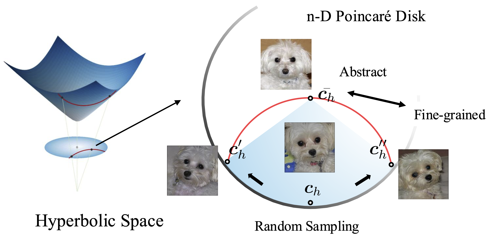
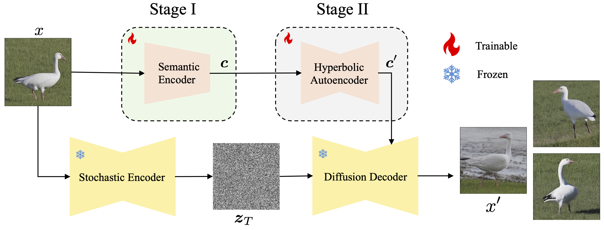

# HypDAE: Hyperbolic Diffusion Autoencoders for Hierarchical Few-shot Image Generation (ICCV 2025)

<div align="center">

[](https://lingxiao-li.github.io/hypdae.github.io/)
[](https://arxiv.org/abs/2411.17784)
[](https://huggingface.co/lingxiao2049/HypDAE)
[](https://opensource.org/licenses/Apache-2.0)

**[Lingxiao Li](https://gwang-kim.github.io/)** · **Kaixuan Fan** · **[Boqing Gong](https://boqinggong.github.io/)** · **[Xiangyu Yue](https://xyue.io/)**

*International Conference on Computer Vision (ICCV), 2025*

</div>

---

<div align="center">
  
</div>

> **Abstract:** Few-shot image generation aims to generate diverse and high-quality images for an unseen class given only a few examples in that class. A key challenge in this task is balancing category consistency and image diversity, which often compete with each other. Moreover, existing methods offer limited control over the attributes of newly generated images. In this work, we propose **Hyperbolic Diffusion Autoencoders (HypDAE)**, a novel approach that operates in hyperbolic space to capture hierarchical relationships among images from seen categories. By leveraging pre-trained foundation models, HypDAE generates diverse new images for unseen categories with exceptional quality by varying stochastic subcodes or semantic codes. Most importantly, the hyperbolic representation introduces an additional degree of control over semantic diversity through the adjustment of radii within the hyperbolic disk.

<div align="center">
   
</div>

## 🛠️ Setup

Our codebase is built on [TF-ICON](https://github.com/Shilin-LU/TF-ICON) and [Paint-by-Example](https://github.com/Fantasy-Studio/Paint-by-Example).

### Environment

```bash
# Clone the repository
git clone [https://github.com/lingxiao-li/HypDAE.git](https://github.com/lingxiao-li/HypDAE.git)
cd HypDAE/HypDiffusion

# Create and activate the conda environment
conda env create -f hypdae_env.yaml
conda activate hypdae
````

### Model Weights

Download the pre-trained HypDAE checkpoints from [Hugging Face](https://huggingface.co/lingxiao2049/HypDAE) and place them in the `checkpoints/` directory.

## 📂 Data Preparation

We use the following datasets for training and evaluation. Please download and unzip them into the `data/` folder.

| Dataset | Link | Description |
| :--- | :--- | :--- |
| **AnimalFaces** | [HuggingFace](https://huggingface.co/lingxiao2049/HypDAE/blob/main/animals.zip) | 149 carnivorous animal classes |
| **Flowers** | [HuggingFace](https://huggingface.co/lingxiao2049/HypDAE/blob/main/flowers.zip) | Oxford 102 Flower Dataset |
| **VGGFaces** | [HuggingFace](https://huggingface.co/lingxiao2049/HypDAE/blob/main/vggfaces.zip) | Face recognition dataset |
| **NABirds** | [Download](https://dl.allaboutbirds.org/nabirds) | North America Birds dataset |
| **FFHQ** | [Kaggle](https://www.kaggle.com/datasets/arnaud58/flickrfaceshq-dataset-ffhq) | Flickr-Faces-HQ Dataset |

**Recommended Directory Structure:**

```text
HypDAE/
├── HypDiffusion/
├── data/
│   ├── animals/
│   ├── flowers/
│   ├── vggfaces/
│   ├── nabirds/
│   └── ffhq/
└── ...
```

## 🚀 Inference

We provide two modes for inference: interactive notebook demo and batch generation script.

### 1\. Interactive Demo

For interactive visualization and testing, use the provided Jupyter Notebook. You can modify the file paths inside the notebook to test different images.

```bash
# Open the notebook
jupyter notebook HypDiffusion/test_ddim.ipynb
```

### 2\. Batch Generation

For batch generation and evaluation, run the following script. You can adjust the parameters (e.g., related paths) inside the script or pass them as arguments.

```bash
# Run batch inference
sh HypDiffusion/inference_for_eva.py
```

## 🏋️‍♂️ Training


## 🙏 Acknowledgments

This project is based on [TF-ICON](https://github.com/Shilin-LU/TF-ICON) and [Paint-by-Example](https://github.com/Fantasy-Studio/Paint-by-Example). We thank the authors for their open-source contributions.

## 📝 Citation

If you find this code or our paper useful for your research, please consider citing:

```bibtex
@inproceedings{Li25HypDAE,
  title     = {HypDAE: Hyperbolic Diffusion Autoencoders for Hierarchical Few-shot Image Generation},
  author    = {Lingxiao Li and Kaixuan Fan and Boqing Gong and Xiangyu Yue},
  booktitle = {International Conference on Computer Vision (ICCV)},
  year      = {2025}
}
```

```
```
